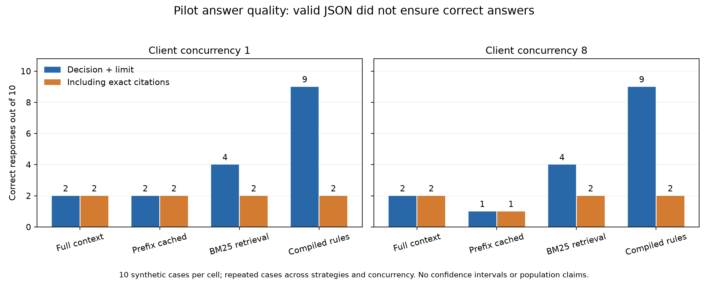
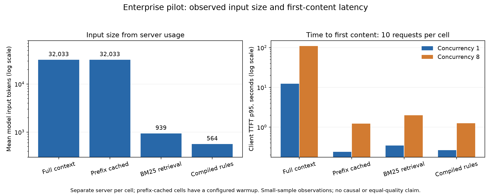

# Final results: bounded Cloud Run pilot

**Pilot execution and artifact consistency: PASS. Full benchmark: not executed.**

The selected evidence consists of 17 completed original cells and one successful
complete-cell rerun. There are 180 successful measured responses, representing
ten unique synthetic expense cases repeated across 18 configurations. Warmups
are excluded from those 180 measurements. The original failed attempt is retained
separately. This report closes that bounded pilot without presenting it as the
full experiment.

## Measurement and scoring contract

- Model: `Qwen/Qwen2.5-7B-Instruct`, revision
  `a09a35458c702b33eeacc393d103063234e8bc28`.
- Serving: installed vLLM `0.29.0+cu129`, Torch `2.13.0+cu129`, CUDA 12.9 build;
  the server version endpoint reports release `0.29.0`.
- Hardware: one NVIDIA L4; observed driver `580.126.20`; job configuration uses
  eight vCPUs and 32 GiB system RAM.
- Serving settings: bfloat16, 72K configured model context, 256-token output cap,
  structured JSON output, GPU memory utilization 0.92. Effective launch commands
  are preserved in the evidence manifest.
- Each task starts a fresh server. Client concurrency is one or eight; it is not
  a count of simultaneously active GPU sequences.
- Schema validity checks types, required fields and allowed values. Decision
  correctness checks event ID, approve/reject/abstain and exact monetary limit.
  Strict correctness additionally requires all expected rule IDs and no unrelated
  rule IDs. Nonempty free-text reasons are required but not semantically scored.
- TTFT is client time to first nonempty content/reasoning, not pure prefill time.
  The request timeout is a read/inactivity timeout, not a total-duration deadline.

## Aggregate checks

| Outcome | Count |
| --- | ---: |
| Selected completed cells | 18/18 |
| Transport-successful measured responses | 180/180 |
| Valid JSON schema | 180/180 |
| Correct event/decision/limit | 63/180 (35%) |
| Fully correct, including citations | 36/180 (20%) |
| Decision/limit correct but citations incorrect | 27/180 |
| Incorrect event/decision/limit | 117/180 |
| Required rules present in context, corrected calculation | 162/180 |
| Required rules present under the original mismatched-ID calculation | 20/180 |

The aggregate mixes strategies, sizes and cache states and repeats the same cases.
It is useful for evidence accounting, not a general accuracy estimate. All
responses were independently rescored against the archived ground truth; their
recorded scores agree. The dataset's separate decision oracle agrees with the
archived expected decisions, limits and applied rules. Examples and interpretation
are in [the quality review](quality-review.md).

## Enterprise strategy comparison

Each entry below represents ten cases. Input token counts are server-reported
means and are the same at both concurrency levels in these observations.

| Strategy | Mean input tokens | Decision correct c1 / c8 | Strict correct c1 / c8 | TTFT p95 seconds c1 / c8 |
| --- | ---: | --- | --- | --- |
| Full context | 32,033.4 | 2/10 / 2/10 | 2/10 / 2/10 | 12.45 / 110.37 |
| Prefix-cached full context | 32,033.4 | 2/10 / 1/10 | 2/10 / 1/10 | 0.24 / 1.23 |
| BM25 retrieval | 939.4 | 4/10 / 4/10 | 2/10 / 2/10 | 0.34 / 1.98 |
| Compiled annotated rules | 564.2 | 9/10 / 9/10 | 2/10 / 2/10 | 0.26 / 1.25 |

The prefix-cached enterprise cells include one configured warmup; a separately
named warm-prefix experiment uses its own warmup configuration. Prompt content
for cached and uncached full context is the same, but server cache settings and
history differ. BM25 uses paragraph chunks, top-k eight and fixed keyword scoring.
Compilation selects from explicit source annotations using typed predicates; it
does not extract knowledge from arbitrary enterprise prose or use expected answers.

Shorter inputs and caching correlate with lower first-content latency here, but
the study does not establish equal-quality speedups or causal mechanisms. The
compiled strategy's stronger decision-only score does not satisfy the strict
citation contract. Retrieval contexts contain every required rule in only 2/20
enterprise responses, exposing actual evidence-selection failures.

## Timeout recovery and memory

The original 32K/concurrency-eight cell completed seven measured requests and
recorded three `ReadTimeout` errors near 120 seconds while waiting for streamed
content. It is a failed observation under that timeout, not discarded evidence.
The new execution reran the entire ten-request cell with the same seeds,
warmup, input dataset, concurrency and model settings, but a 600-second read
timeout. All ten requests completed. Its p95 TTFT was 187.69 seconds, p95 request
latency 196.55 seconds and measured batch time 245.94 seconds. Only one of its ten
answers passed the full answer-and-citation contract; five passed decision/limit
correctness. The two attempts must remain distinguished by their timeout.

The observed KV allocation is 4.29 GiB / 80,240 tokens. The 32K label is a regex
count; actual prompts average 40,591.4 model input tokens. With uncached inputs
this size, the server reported one active request and multiple deferred requests.
Client concurrency eight therefore generated queueing rather than eight active
long GPU sequences. The largest sampled KV fraction was about 97.7%, in the
8K/concurrency-eight cell. Each cell's sampled GPU memory peak was 20,510 MiB on
a device reporting 23,034 MiB. Host-memory peaks were not collected.

No selected run has a recorded request OOM or a server ERROR before teardown.
Three server logs contain `EngineDeadError` during forced engine shutdown, after
benchmark completion. Those are teardown observations, not failed model requests.

## Application time and the full-run limit

Selected application-recorded task durations range from 9m 47s to 17m 05s. Their
sum is 3.78 hours; measured request batches sum to 24.4 minutes. The remainder
includes fixture generation, GPU/model startup, warmups, artifact I/O and cleanup.
These are not billing measurements and omit platform scheduling/image-start time.

The full scaling config specifies 60 events times ten repetitions: 600 requests
per cell. The observed 32K c1 and c8 batches took 242.21 and 245.94 seconds for ten
requests. Linear scaling gives approximately 4.04 and 4.10 hours of measured work
for 600 requests, before startup. This is an extrapolation, not a full-run
measurement, and the remaining event mix could change it. The margin over the
one-hour Cloud Run GPU-task limit is nevertheless large. Adding more tasks does
not automatically partition a cell. Partitioning changes admission/cache/server
lifetime and needs a deliberate protocol decision; preserving a whole cell calls
for a longer-lived execution platform.

The pilot did not measure concurrency 32 or scaling 16K/64K. Regex context labels
are not exact model-token counts; model-token fit for the full 64K case remains
unverified against the 73,728-token model limit. The full enterprise configuration
also needs an explicit dataset decision: the pilot uses the 60-event enterprise
dataset, while the default `configs/experiment.yaml` points at the five-event
synthetic smoke dataset. Those frozen inputs were not silently changed.

## Coverage correction and provenance

The coverage correction compares expected rule IDs with complete selected rule
annotations, including complete-span checks for retrieval. It does not compare
document filenames or chunk IDs with rule IDs. Raw artifacts remain immutable;
the derived response file preserves the old fields alongside the correction.
Required-rule presence alone is not a minimum safe context or proof of correct
reasoning. Correcting this field leaves the 36/180 strict answer score unchanged.

The manifest hashes the selected inputs and original failed attempt, records
effective configs and matches historical client file hashes. Exact execution
source commits and complete built-image digests were not recorded in the uploaded
artifacts. A compatible client commit is identified by content, not asserted as
the full image's commit. Cloud Shell recovery commands are supplied in the
[reproducibility guide](README.md). No cost claim is made without billing data.

## Closeout decision

This is a completed, auditable pilot with useful negative quality findings and
deployment lessons. It supports a bounded pilot article. It does not support
claims about production readiness, general superiority of a strategy, a minimum
safe context size, full-matrix completion or measured full-run cost/duration.
The full benchmark remains future work rather than an implied publication prerequisite.
